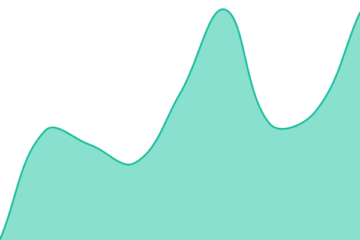

# [Timesifier status](https://status.timesifier.com): <!--live status--> **🟧 Partial outage**

Whether [Timesifier](https://timesifier.com) is up. Every 5 minutes, [Upptime](https://upptime.js.org) on GitHub Actions checks the application's `/health` check and its four public pages. These checks run on GitHub's servers, outside Cloudflare, where Timesifier runs.

- **The status page:** [status.timesifier.com](https://status.timesifier.com), served by GitHub Pages.
- **If that address does not open:** this page shows the same table, and every outage is an [issue](https://github.com/ayoinc/timesifier-status/issues) that opens when the outage starts and closes when it ends. The address's DNS is at Cloudflare, but this page's is not.

<!--start: status pages-->
<!-- This summary is generated by Upptime (https://github.com/upptime/upptime) -->
<!-- Do not edit this manually, your changes will be overwritten -->
<!-- prettier-ignore -->
| URL | Status | History | Response Time | Uptime |
| --- | ------ | ------- | ------------- | ------ |
|  [Health](https://timesifier.com/health) | 🟥 Down | [health.yml](https://github.com/ayoinc/timesifier-status/commits/HEAD/history/health.yml) | 

 191ms
     
 | 

<a href="https://status.timesifier.com/history/health">100.00%</a>
    

|  [Home page](https://timesifier.com/) | 🟩 Up | [home-page.yml](https://github.com/ayoinc/timesifier-status/commits/HEAD/history/home-page.yml) | 

 280ms
     
 | 

<a href="https://status.timesifier.com/history/home-page">100.00%</a>
    

|  [Sign-in page](https://timesifier.com/sign-in) | 🟩 Up | [sign-in-page.yml](https://github.com/ayoinc/timesifier-status/commits/HEAD/history/sign-in-page.yml) | 

 214ms
     
 | 

<a href="https://status.timesifier.com/history/sign-in-page">100.00%</a>
    

|  [Privacy notice](https://timesifier.com/privacy) | 🟩 Up | [privacy-notice.yml](https://github.com/ayoinc/timesifier-status/commits/HEAD/history/privacy-notice.yml) | 

 273ms
     
 | 

<a href="https://status.timesifier.com/history/privacy-notice">100.00%</a>
    

|  [Terms](https://timesifier.com/terms) | 🟩 Up | [terms.yml](https://github.com/ayoinc/timesifier-status/commits/HEAD/history/terms.yml) | 

 210ms
     
 | 

<a href="https://status.timesifier.com/history/terms">100.00%</a>
    

<!--end: status pages-->

## How this repository works

| Workflow         | When                                                               | What it may do with its `GITHUB_TOKEN`                                                   |
| ---------------- | ------------------------------------------------------------------ | ---------------------------------------------------------------------------------------- |
| Uptime CI        | every 5 minutes                                                    | `contents: write`, `issues: write`: commit each result; open and close an outage's issue |
| Response Time CI | daily, 23:00 UTC                                                   | `contents: write`, `issues: read`: commit the day's response times                       |
| Graphs CI        | daily, 00:00 UTC                                                   | `contents: write`: commit the graphs                                                     |
| Summary CI       | daily, 00:00 UTC                                                   | `contents: write`, `issues: read`: commit this README's table                            |
| Setup CI         | on a change to `.upptimerc.yml`                                    | `contents: write`, `issues: write`: run all four of the above once                       |
| Static Site CI   | daily, 01:00 UTC, and on a change to `.upptimerc.yml` or `assets/` | build: `contents: read`; publish: `pages: write`, `id-token: write`                      |

- **No personal access token and no app.** Every workflow runs on that run's own `GITHUB_TOKEN`, and the repository's default token permission is read-only. Each workflow asks for exactly the permissions it needs, as listed above.
- **Every action is pinned to a commit.** The workflows are this repository's own. Upptime's "Update Template CI" and "Updates CI" are left out: they rewrite the workflows from Upptime's latest release, which would need a token that can change workflows. To move to a newer Upptime, change the pinned commit in a reviewed pull request.
- **No settings changes.** `GITHUB_TOKEN` cannot change a repository's description, topics or homepage, or delete an issue. `.upptimerc.yml` tells Upptime not to try.
- **What is checked** is in [`.upptimerc.yml`](./.upptimerc.yml). `/health` counts as down unless it answers 200 with `"status":"ok"` in its body.

[MIT](./LICENSE). Upptime © Anand Chowdhary.
